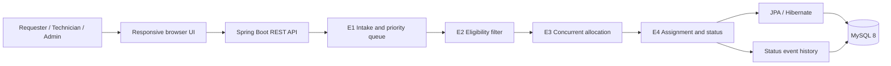
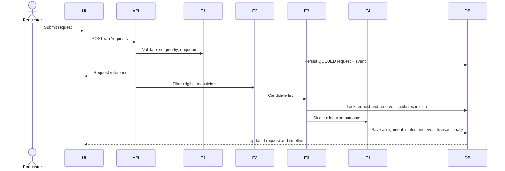
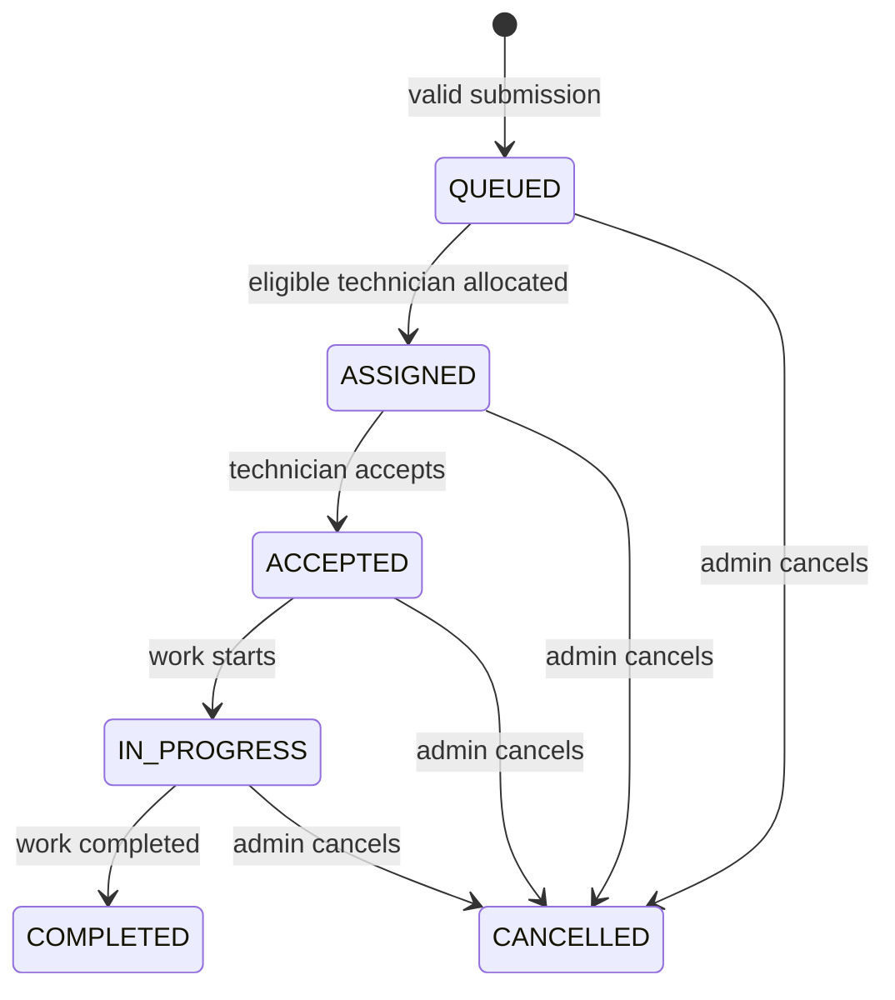

# Architecture and requirement evidence

## Component architecture



## ER diagram

```mermaid
erDiagram
 APP_USER ||--o{ SERVICE_REQUEST : submits
 SERVICE_CATEGORY ||--o{ SERVICE_SUBCATEGORY : contains
 SERVICE_SUBCATEGORY ||--o{ SERVICE_REQUEST : classifies
 SERVICE_REQUEST ||--o| SERVICE_ASSIGNMENT : receives
 APP_USER ||--o{ SERVICE_ASSIGNMENT : technician
 SERVICE_REQUEST ||--o{ STATUS_EVENT : records
 APP_USER ||--o{ STATUS_EVENT : acts
 APP_USER ||--o| TECHNICIAN_PROFILE : has
 APP_USER { bigint id PK; string username UK; string displayName; string passwordHash; string role }
 TECHNICIAN_PROFILE { bigint userId PK_FK; string skills; string locations; boolean available; int maxActive }
 SERVICE_CATEGORY { bigint id PK; string name; boolean active }
 SERVICE_SUBCATEGORY { bigint id PK; bigint categoryId FK; string name; string skill; string defaultPriority }
 SERVICE_REQUEST { bigint id PK; bigint requesterId FK; bigint subcategoryId FK; string location; string priority; string status; datetime createdAt }
 SERVICE_ASSIGNMENT { bigint id PK; bigint requestId FK_UK; bigint technicianId FK; datetime assignedAt }
 STATUS_EVENT { bigint id PK; bigint requestId FK; bigint actorId FK; string fromStatus; string toStatus; datetime createdAt }
```

## Assignment sequence



## Lifecycle



## Requirement traceability

| Requirement | Implementation | Evidence |
|---|---|---|
| FR-01–03 | E1 request validation, category defaults, priority/FIFO queue | `EngineService.submit`, `/api/queue` |
| FR-04–05 | E2 skill/location/availability/capacity filtering | `EngineService.allocate` |
| FR-06–08 | E3 JVM mutual exclusion, DB row lock, unique assignment | `EngineService.allocate`, concurrent integration test |
| FR-09–10 | E4 transactional lifecycle and status event history | `changeStatus`, `/api/requests/{id}/events` |
| NFR-01, 03 | Single confirmed assignment under simultaneous calls | `EngineIntegrationTest` |
| NFR-02, 05 | Assignment + request/event saved transactionally | `@Transactional` E3/E4 operations and database constraints |
| NFR-04 | Each transition records actor, timestamp, old and new state | `StatusEvent` |
| NFR-06 | Candidate filtering work scales with technician count; benchmark threshold still needs the project team's numeric target | E2 filter |
| NFR-07 | Request ownership and role checks on protected endpoints | API controller guards |
| NFR-08 | Requirement-to-engine and verification references above | This table |

The source Gate 1 names the NFR-06 threshold as “project-agreed” but does not set a number. No threshold is invented here; set it before a formal performance benchmark.
